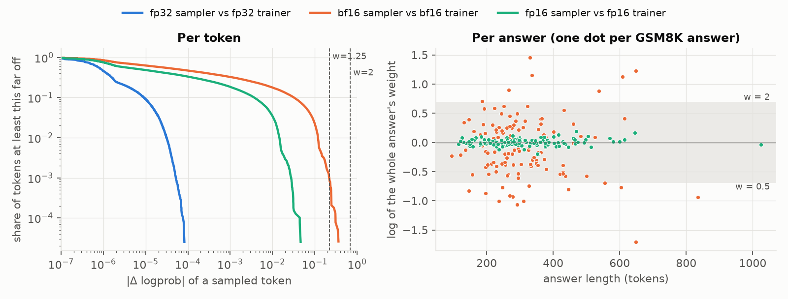
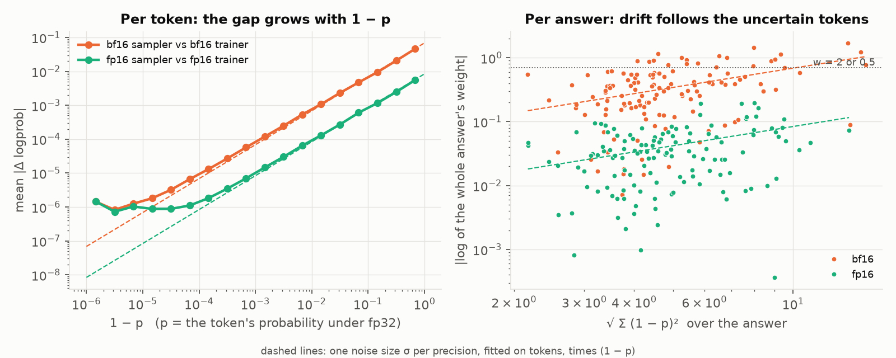
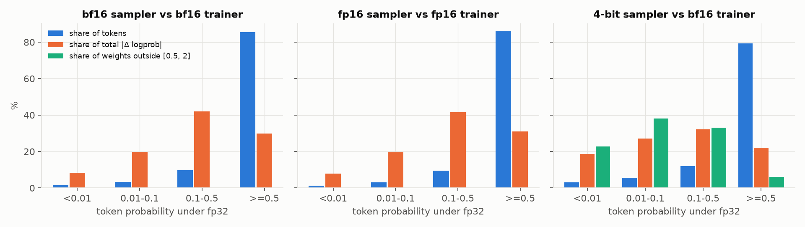
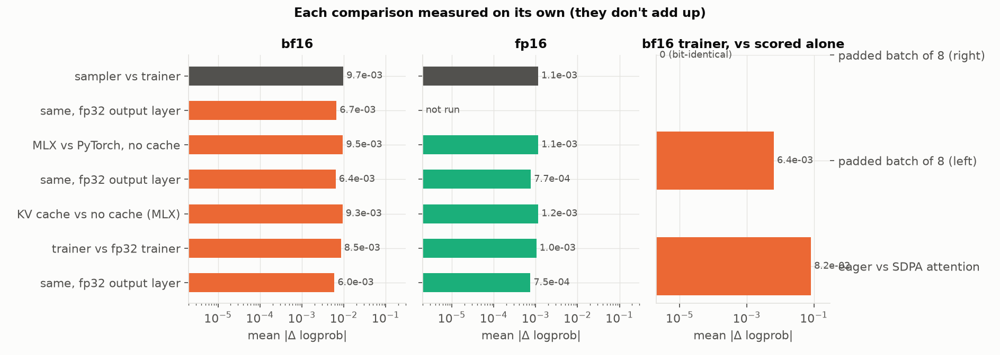

# logprob-gap

RL frameworks for language models usually sample with one engine and train
with another, and the two don't compute exactly the same token probabilities.
I wanted to see how big that gap is on a small model, and where it comes from.

```
uv run python run.py
```

This samples answers to GSM8K questions with MLX (one token at a time with a
KV cache, recording each sampled token's logprob the way an RL rollout worker
does), then scores the exact same tokens again with PyTorch on the Mac's GPU
(one teacher-forced pass over the whole sequence, the way a trainer does). It
does that at several precisions, measures the difference token by token, and
compares each pair of computations on its own: with and without the KV cache,
MLX against PyTorch, each precision against fp32, the output layer in fp32,
and batching.

It's Qwen2.5-1.5B-Instruct (and Qwen2.5-0.5B as a check) on an M4 MacBook
Pro with 32 GB. MLX and PyTorch
stand in for an inference engine and a trainer, and nothing is trained, so
this measures the gap at one fixed set of weights. "fp32" below means the
bf16 checkpoint run with fp32 arithmetic.

## Results

128 GSM8K test questions, one answer each at temperature 1, up to 1,024 new
tokens (about 39,000 sampled tokens per config). Every number below is in
[`results/qwen2.5-1.5b-instruct/summary.md`](results/qwen2.5-1.5b-instruct/summary.md).



| sampler | trainer | mean \|Δ logprob\| | max \|Δ logprob\| | k3 KL | tokens with w outside [0.8, 1.25] | tokens clipped at C = 2 | answers with w outside [0.5, 2] |
|---|---|---|---|---|---|---|---|
| fp32 | fp32 | 3.1e-6 | 8.2e-5 | 2.4e-11 | 0 | 0 | 0 |
| bf16 | bf16 | 0.0097 | 0.37 | 3.7e-4 | 0.09% | 0 | 16% |
| fp16 | fp16 | 0.0011 | 0.046 | 5.4e-6 | 0 | 0 | 0 |
| 8-bit | bf16 | 0.013 | 0.73 | 6.5e-4 | 0.35% | 0 | 19% |
| 4-bit | bf16 | 0.16 | 9.6 | 0.063 | 20% | 1.7% | 98% |

### bf16 against fp16

With the sampler and trainer at the same precision, the average sampled
token's logprob differs by 0.0097 in bf16 and 0.0011 in fp16 (95% CIs 0.0087
to 0.0108 and 0.0011 to 0.0012), 8.5 times less. The k3 KL estimate drops
about 70 times, from 3.7e-4 to 5.4e-6, since it goes roughly with the square.

Those two numbers come from different rollouts, so I also compared on
identical tokens: PyTorch bf16 and PyTorch fp16, each against PyTorch fp32.
The ratio is 8.0 overall and between 7.9 and 8.1 on every config's rollouts.
bf16 keeps 8 significant bits and fp16 keeps 11, so if the gap were nothing
but rounding the ratio would be 2^3 = 8.

### Small per token, large per answer

In bf16 no single token's weight left [0.5, 2]; the worst was off by a factor
of e^0.365 = 1.44. So truncated importance sampling with a cap of 2 would
have clipped nothing. Multiplied over a whole answer, though, 21 of 128
answers (16%) had a weight outside [0.5, 2]. In fp16, none did.

How far an answer drifts depends on how uncertain it is more than on its
length. A simple model fits the data: each token's log ratio is independent noise of
size σ(1 − p), where p is the token's probability. σ is 0.086 in bf16 and
0.0105 in fp16 (8.2 times apart), and the noise at neighboring tokens is
uncorrelated (lag-1 autocorrelation −0.01). Under that model an answer's log
weight, divided by √Σ(1 − p)², should have the same spread at every length,
and it does: 0.089, 0.098 and 0.093 for answers under 256 tokens, 256 to 511,
and 512 or more. Divided by √length instead, it jumps from 0.027 to 0.041 for
the longest answers, which are also much less certain (0.88 nats per token
under fp32, against about 0.3 for the rest) and were all wrong answers.



The mean log weight over bf16 answers is −0.075, close to the −0.11 that the
summed k3 predicts. It's negative because the sampler picks tokens it rates a
little higher than the trainer does.

### Which tokens

Tokens that fp32 gave less than 0.5 probability are 15% of bf16's sampled
tokens, 70% of the total |Δ logprob| and 86% of the sum of squares (the part
that drives whole-answer drift). Below 0.5, |Δ logprob| divided by (1 − p) is
about 0.06 in every bin, which is the shape of the bound in the
vocabulary-pruning paper and what you'd get from a small error in the logits
passing through the softmax. That paper also argues that errors on tail
tokens are biased in one direction. I don't see that here: the signed mean
in each bin is within ±0.002 of zero.



### Where it comes from

In bf16 I expected the KV cache or the framework to be the main piece. Each
of the three bf16 paths (MLX with the cache, MLX without it, PyTorch) is
about 0.0085 from PyTorch fp32, and their errors correlate only about 0.25
with each other. They behave like separate rounding draws, so any two of them
differ by a bit more than either differs from fp32: cache against no cache is
0.0093, MLX against PyTorch 0.0095. These comparisons don't add up to the
sampler-vs-trainer gap; each is its own measurement. fp16 has the same
pattern at about an eighth of the size.

Part of every bf16 number above is the last step. Both sides cast the
logits to fp32 before the softmax, but the logits come out of the output
layer already rounded to bf16, and for this model they sit around 24 to 35,
where bf16's steps are 0.125 to 0.25 wide. Running the output layer in fp32
on both sides cuts the bf16 sampler-vs-trainer gap from 0.0097 to 0.0067 per
token, the k3 KL from 3.7e-4 to 1.6e-4, and the answers whose weight leaves
[0.5, 2] from 21 of 128 to 5. fp16 drops by about the same third (0.0011 to
0.00077 between MLX and PyTorch). The rest comes from the transformer body.
For the sampler side this replays the bf16 rollouts through the same cached
path with each token forced, since sampling again would change the tokens.



### Batching and controls

Scoring a sequence inside a right-padded batch of 8 gave bit-identical
logprobs for all 193,974 tokens, across every config's rollouts. The harness
can see smaller changes than that. With left padding and explicit positions,
so each sequence still starts at position 0 but sits at a different offset
in memory, only 31% of tokens came out identical, with a mean difference of
0.0064, close to a fresh bf16 rounding. Swapping PyTorch's fused SDPA
attention for Hugging Face's eager attention, which rounds the attention
scores and weights to bf16 along the way, moved the trainer ten times further
from fp32 (0.081 against 0.0085), with 1.9% of tokens off by more than a
factor of 2. On the 1.5B model, right padding is free, and an attention
path that rounds its scores costs more than the choice between bf16 and
fp16 (on the 0.5B model below it mattered much less).

Replaying the first 8 rollouts of each precision through the sampler's
cached path gave back the recorded logprobs bit for bit, so the stored
rollouts are what the current code produces.

### Quantized samplers

8-bit is a third worse than bf16 per token (0.013) and 1.75 times worse in k3
(6.5e-4), with 19% of answers outside [0.5, 2]. 4-bit is a different policy:
0.16 per token, 7.3% of tokens with a weight outside [0.5, 2], 1.7% clipped
at C = 2, and almost every answer far outside [0.5, 2]. Part of that is its
own token mix: on 4-bit's rollouts even PyTorch bf16 against fp32 is 0.0112,
against 0.0085 on bf16's. The 4-bit sampler also got fewer answers right
(45%, against 59% to 66% for the others; with 128 questions, a few points
between the other four is noise).

### Same seed, different text

Every config samples prompt i with seed i, so the texts only split where the
numbers push a draw the other way. fp16 wrote the same answer as fp32 for 106
of 128 questions, bf16 for 46, 8-bit for 28 and 4-bit for none.

### A second size

The same run on Qwen2.5-0.5B-Instruct, at fp32, bf16 and fp16 only
([summary](results/qwen2.5-0.5b-instruct/summary.md)), mostly agrees. The
bf16 gap is 0.0123 per token against 0.0015 in fp16, 8.2 times, and on
identical tokens the ratio is 7.7. In bf16 no token's weight left [0.5, 2]
but 24 of 128 answers did, and in fp16 none did. The fp32 output layer
helped less here (0.0123 to 0.0098, and 24 drifting answers to 10).
Right-padded batches were again bit-identical, and left-padded ones were not.

Two things didn't carry over cleanly. Eager attention was only about 1.5
times the bf16 noise instead of 10 times, so how much the attention path
matters depends on the model. And dividing the answer weights by
√Σ(1 − p)² didn't flatten their spread across lengths any better than
√length did (0.13, 0.09, 0.11 against 0.036, 0.024, 0.041), so the noise
model describes the 1.5B run well and the 0.5B run only roughly.

### Against the papers

- The FP16 paper's direction holds here: fp16 cuts the gap by about the
  ratio its extra bits predict.
- Feng Yao et al. found tokens where vLLM and FSDP, both in bf16, gave almost
  opposite probabilities. Nothing here comes close (the largest |Δ
  probability| in bf16 is 0.13), so whatever produces those cases in a GPU
  stack isn't present in MLX against PyTorch on MPS. The "it's the
  precision" result above is about these two frameworks only.
- The vocabulary-pruning paper's (1 − p) shape fits; its bias claim doesn't
  show up at this size.
- Thinking Machines' point shows up directly: the same math laid out the
  same way in memory gives identical numbers (right padding), and the same
  math shifted in memory does not (left padding).
- Feng Yao et al. also note that an fp32 output layer in vLLM helps without
  closing the gap, which matches the about-a-third reduction here.

More charts: [the per-token tail](results/qwen2.5-1.5b-instruct/charts/tail.png),
[whole-answer weights for every config](results/qwen2.5-1.5b-instruct/charts/sequence_weights.png),
[the gap by position](results/qwen2.5-1.5b-instruct/charts/by_position.png).

## Setup

Needs an Apple Silicon Mac (MLX and PyTorch's MPS backend) and
[uv](https://docs.astral.sh/uv/). Tested with Python 3.12, mlx 0.32.4,
mlx-lm 0.32.2, torch 2.15.0 and transformers 5.22.2.

```
uv sync
uv run python run.py                                   # about 2.5 hours on an M4
uv run python run.py --prompts 16 --max-new 256        # about 10 minutes, to check it works
uv run python run.py --model Qwen/Qwen2.5-0.5B-Instruct
uv run python run.py --only report                     # redo tables and charts
uv run pytest
```

The first run downloads the model (3 GB) and GSM8K. Results go to
`results/<model>/`. Each stage skips work whose output already exists, so a
run that was stopped picks up where it left off.

## What it measures

For every sampled token there are up to six logprobs of the same token, all
computed from the same prefix with the same weights:

| column | what computed it |
|---|---|
| `lp_sampler` | MLX, decoding step by step with a KV cache, at the sampler's precision |
| `lp_mlx_nocache` | MLX, one full forward pass with no cache, same weights and precision |
| `lp_torch_fp32` | PyTorch on MPS, full forward pass, fp32 (used as the reference policy) |
| `lp_torch_bf16` | same, bf16 |
| `lp_torch_fp16` | same, fp16 |
| `lp_torch_bf16_batch8` | PyTorch bf16 with the sequence inside a right-padded batch of 8 |

The importance weight for a token is w = π_trainer(token) / μ_sampler(token),
so log w = `lp_trainer - lp_sampler`. From those differences:

- mean, 99th percentile and max of |Δ logprob|, and the max |Δ probability|
- the k3 estimate of KL(sampler ‖ trainer): the mean of (w − 1) − log w
- the share of tokens with w outside [0.8, 1.25] and outside [0.5, 2]
- the share that a truncated importance sampling cap of C = 2 would clip
- the gap split by the token's probability under fp32 and by position in the answer
- per answer, the sum of log w (the log of the sequence-level weight) and how
  it spreads with length

Every per-token number is in `results/<model>/tokens.parquet` (one row per
sampled token), and the rollouts, with their text, are in
`rollouts_<config>.parquet`. `summary.md` and `summary.json` are generated from
those.

## How it works

```
run.py
 ├─ sample   for each sampler config (fp32, bf16, fp16, 8-bit, 4-bit):
 │             load the model in MLX at that precision
 │             for each prompt: decode with a KV cache at temperature 1,
 │                              record log μ(token) as it's sampled     gap/sampler.py
 │             rescore every rollout in one pass with no cache          gap/sampler.py
 │             sample the first 4 prompts again and check it's bit-identical
 ├─ ablate   bf16 and fp16 rollouts, in MLX:
 │             replay the first 8 through the cached path, token forced,
 │               and check the logprobs come back bit-identical
 │             rescore with the output layer in fp32 (bf16 also through
 │               the cached path, which is as slow as sampling)
 ├─ score    for fp32, bf16, fp16: load the model in PyTorch on MPS
 │             rescore every rollout from every config, one at a time   gap/trainer.py
 │             bf16 and fp16 again with the output layer in fp32
 │             bf16 again in right-padded and left-padded batches of 8,
 │               and with eager attention instead of SDPA
 └─ report   tables and charts                                          gap/report.py
                                                                        gap/metrics.py
```

Prompts are the first 128 GSM8K test questions in Qwen's chat template with
its usual "reason step by step, put your final answer within \boxed{}" line.
Each config samples prompt i with seed i, so before any rounding difference
flips a draw, every config writes the same text. Generation stops at
`<|im_end|>` or `<|endoftext|>`, or after 1,024 new tokens, and the stop token
is scored like any other, since an RL trainer trains on it too.

## Design choices

- **The softmax is in fp32 everywhere.** Both sides cast the logits to fp32
  before the log-softmax, so none of the gap comes from a bf16 softmax. The
  logits themselves still come out of the last matmul in the model's
  precision, which is what the fp32 output-layer check is about.
- **Only the answer positions go through the output layer.** Both scorers run
  the transformer over the whole sequence and then apply the output layer to
  the answer positions only, which keeps the single and batched PyTorch paths
  identical apart from the batch itself.
- **Each sampler config scores its own rollouts.** I could have sampled once
  and scored those tokens at every precision. But in RL the sampler both picks
  the tokens and reports their probabilities, and a sampler that overrates a
  token is also more likely to pick it. Scoring a config's own rollouts keeps
  that.
- **Bins use the fp32 probability.** When splitting the gap by how likely a
  token was, I bin by the fp32 reference rather than by the sampler's own
  probability, which would push tokens the sampler underrated into the low
  bins. (For the fp32 sampler the trainer side is that reference.)
- **k3 instead of an exact KL.** k3 only needs the sampled token's two
  logprobs, it's unbiased when tokens come from the sampler, and it's what
  veRL logs for this. An exact KL on a subset of positions would be a good
  check; I haven't done it.
- **The fp32 output layer is tested by replay.** To see how much of the gap is
  the logits being rounded to 16 bits, both sides need an fp32 output layer.
  Sampling again would change the tokens, so the sampler side replays the
  existing bf16 rollouts through the same cached decode path with each token
  forced. Replayed without the change, it gives back the recorded logprobs
  bit for bit.
- **Confidence intervals resample whole answers.** Tokens within one answer
  aren't independent, so the bootstrap draws prompts, not tokens.
- **Quantized samplers start from the bf16 weights** (MLX affine quantization,
  group size 64, which also covers the tied embedding and output layer) and
  are compared against the unquantized bf16 trainer, the usual setup for
  quantized rollouts.

## Limitations

- Two small models (1.5B in full, 0.5B at three precisions), one task, 128
  prompts, one answer per prompt. Only 9 of the 1.5B bf16 answers are longer
  than 512 tokens, so the length buckets are small.
- Nothing is trained. The papers below connect this gap to RL runs
  collapsing; this only measures it at fixed weights.
- MLX and PyTorch on MPS are not vLLM or SGLang and FSDP or Megatron on GPUs.
  There's no FlashAttention, tensor parallelism or fp8, and the two
  frameworks also differ in small ways (Hugging Face rounds the RoPE tables
  and the RMSNorm output to bf16; MLX's fused kernels keep them in fp32). The
  next step would be the same harness on one GPU with vLLM serving
  concurrent requests against Hugging Face scoring.
- The sampler decodes one sequence at a time. Real inference engines batch
  many requests together, which Thinking Machines' post identifies as a
  major source of variation, and none of that is tested here. The batch
  checks only cover the trainer.
- Each config is scored on its own rollouts, so configs see slightly
  different token mixes (this inflates the 4-bit numbers by about 30%).
- GSM8K accuracy comes from a quick `\boxed{}` parser and is only there to
  show the samplers still produce sensible answers.

## Tests

`uv run pytest` runs two sets:

- `tests/test_metrics.py`: the metric code on hand-made inputs (the k3
  estimate, including that it matches the exact KL when tokens are drawn in
  proportion and that tiny differences aren't lost to rounding; the weight
  bands; the TIS cap; the probability bins and their edges; the per-answer
  sums; the bootstrap).
- `tests/test_alignment.py`: both scorers on tiny random models, no download.
  The PyTorch scorer picks the right positions, padded batches (right and
  left) match single sequences, the MLX cached and uncached paths agree in
  fp32, replay gives back sampled logprobs exactly, and sampling repeats
  itself with the same seed. Shifting either scorer by one position makes
  these fail.

## Layout

```
run.py            sample, score, report
gap/sampler.py    MLX: KV-cache sampling and no-cache rescoring
gap/trainer.py    PyTorch on MPS: teacher-forced scoring, single or batched
gap/metrics.py    the numbers
gap/report.py     tables and charts
gap/prompts.py    GSM8K prompts and answer checking
tests/            metric tests and scorer alignment tests
results/          the two runs shown above
```

## Reading

- Feng Yao, Liyuan Liu, Dinghuai Zhang, Chengyu Dong, Jingbo Shang, Jianfeng
  Gao, [Your Efficient RL Framework Secretly Brings You Off-Policy RL Training](https://fengyao.notion.site/off-policy-rl)
  (2025). Names the problem and proposes truncated importance sampling.
- Penghui Qi, Zichen Liu, Xiangxin Zhou, Tianyu Pang, Chao Du, Wee Sun Lee,
  Min Lin, [Defeating the Training-Inference Mismatch via FP16](https://arxiv.org/abs/2510.26788)
  (2025). Argues bf16's rounding is the main cause and fp16 fixes most of it.
- Horace He and Thinking Machines, [Defeating Nondeterminism in LLM Inference](https://thinkingmachines.ai/blog/defeating-nondeterminism-in-llm-inference/)
  (2025). Batch invariance, and bitwise-identical sampling and training.
- Yingru Li et al., [Dynamic Vocabulary Pruning: Stable LLM-RL by Taming the Tail](https://arxiv.org/abs/2512.23087)
  (2025, revised 2026). Shows the mismatch bound is largest for low-probability
  tokens.
- The [veRL rollout correction docs](https://verl.readthedocs.io/en/latest/algo/rollout_corr.html)
  for how TIS and these metrics are used in practice.
